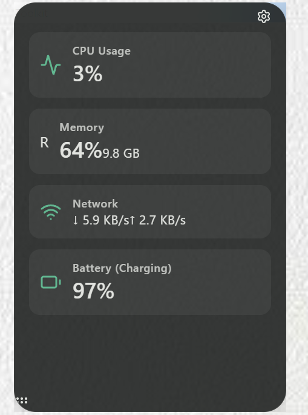

# Toolkit - System Status Monitor


<p align="center">
    
    
    
</p>

**Toolkit** is a lightweight, high-aesthetic system status monitor for Windows, built with **Tauri**, **React**, and **Rust**.

Inspired by Material You design principles, it provides a beautiful, transparent, and always-on-top floating window to keep track of your system's vital statistics without cluttering your workspace.
<p align="center">
    
</p>
## ✨ Features

*   **Real-time Monitoring**:
    *   **CPU Usage**: Real-time percentage tracking.
    *   **RAM Usage**: Usage percentage and absolute value (GB).
    *   **Network Speed**: Real-time download and upload speeds.
    *   **Battery Status**: Battery level and charging state.
*   **Modern Design**:
    *   **Material You Aesthetics**: sleek, modern UI with dynamic transparency.
    *   **Floating Window**: Borderless, always-on-top window that floats over other apps.
    *   **Draggable**: Easily move the widget anywhere on your screen.
*   **Lightweight**: Built on Tauri (Rust), ensuring minimal resource footprint compared to Electron alternatives.

## 🛠️ Tech Stack

*   **Frontend**: React, TypeScript, Vite, TailwindCSS
*   **Backend**: Rust (Tauri), `sysinfo` crate
*   **Design**: Custom CSS variables implementing Material Design tokens

## 🚀 Getting Started

### Prerequisites

*   [Node.js](https://nodejs.org/) (v16 or newer)
*   [Rust](https://www.rust-lang.org/tools/install) (latest stable)
*   [WebView2](https://developer.microsoft.com/en-us/microsoft-edge/webview2/) (Pre-installed on Windows 10/11)

### Installation

1.  **Clone the repository**:
    ```bash
    git clone https://github.com/AndrewWangDev/monitor_tool.git
    cd monitor_tool
    ```

2.  **Install dependencies**:
    ```bash
    npm install
    # or
    yarn install
    # or
    pnpm install
    ```

3.  **Run in Development Mode**:
    ```bash
    npm run tauri dev
    ```

### Building for Production

To create a standalone executable (`.exe`):

```bash
npm run tauri build
```

The output file will be located in `src-tauri/target/release/bundle/nsis/`.

## 🤝 Contributing

Contributions are welcome! Please feel free to submit a Pull Request.

1.  Fork the Project
2.  Create your Feature Branch (`git checkout -b feature/AmazingFeature`)
3.  Commit your Changes (`git commit -m 'Add some AmazingFeature'`)
4.  Push to the Branch (`git push origin feature/AmazingFeature`)
5.  Open a Pull Request

## 📄 License

This project is licensed under the MIT License - see the [LICENSE](LICENSE) file for details.
